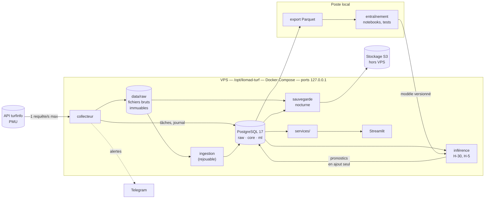

# Architecture technique — ILOMAD-TURF

> **Version** : 1.0 | **Date** : 10/10/2026 | **Auteur** : Olivier MORA avec Claude Code

Ce document décrit **comment** l'application est construite. Les exigences sont dans le [cahier des charges](./CAHIER-DES-CHARGES.md), le comportement de la source dans [SPEC-SOURCE-PMU.md](./SPEC-SOURCE-PMU.md), le « pourquoi » de chaque choix dans [adr/](./adr/).

---

## 1. Vue d'ensemble



Quatre principes structurent tout le reste ([ADR 0001](./adr/0001-brut-d-abord-et-point-in-time.md)) :

1. **Brut d'abord.** Toute réponse HTTP est stockée telle quelle, avec son heure de collecte, avant tout traitement.
2. **Point-in-time.** Une variable ne voit que ce qui était connu à l'heure du pronostic.
3. **Liste blanche** des champs utilisables avant course.
4. **Pronostics en ajout seul**, antérieurs au départ.

---

## 2. Stack technique

| Composant | Choix | Justification |
|-----------|-------|---------------|
| Langage | Python 3.13 | Écosystème data et ML, compétence interne |
| Dépendances | uv | Verrouillage reproductible, rapide |
| Client HTTP | httpx | Délais et reprises maîtrisés, même API en synchrone et asynchrone |
| Base de données | PostgreSQL 17 | Contraintes fortes (ajout seul, clés étrangères), `timestamptz`, déjà maîtrisé |
| Accès aux données | SQLAlchemy 2, migrations Alembic | Schéma versionné dans le code |
| Calcul | Polars | Jointures temporelles rapides, faible empreinte mémoire |
| Modèles | statsmodels (logit conditionnel), LightGBM (classement), scikit-learn (calibration) | Progression du plus simple au plus fin |
| Ligne de commande | Typer | Une commande par étape : `collect`, `backfill`, `parse`, `export`, `train`, `predict`, `evaluate` |
| Interface | Streamlit | Développement rapide, un seul utilisateur |
| API | FastAPI (« Should ») | Habillage de la couche `services/` |
| Conteneurs | Docker Compose | Isolation sur un VPS partagé |
| Alertes | Bot Telegram | Aucune infrastructure à maintenir |
| Sauvegarde | `pg_dump` et rclone vers un stockage S3 | Copie hors VPS |
| Qualité | pytest, ruff | |

Ce qui est volontairement absent du MVP : MLflow, Prefect, React ([ADR 0002](./adr/0002-outillage-minimal.md)).

---

## 3. Composants

Chaque composant fait une seule chose. Tous partagent le même paquet Python `turf` et la même image Docker ; seule la commande lancée diffère.

| Composant | Rôle | Entrées | Sorties | Module |
|-----------|------|---------|---------|--------|
| **Collecteur** | Interroger la source selon le calendrier, au débit plafonné | Programme du jour, `raw.tache_collecte` | Fichiers bruts, `raw.document` | `collecte/` |
| **Ingestion** | Transformer le brut en tables propres ; rapprocher chevaux et personnes | Fichiers bruts | `core.*` | `ingestion/` |
| **Variables** | Calculer les variables d'un partant telles que connues à une heure donnée | `core.*`, heure de pronostic | Tableau de variables | `features/` |
| **Modèles** | Marché, logit conditionnel, boosting, combinaison, calibration, Plackett-Luce | Variables | Probabilités, artefact versionné | `modeles/` |
| **Évaluation** | Métriques, validation glissante, paris fictifs | `ml.prediction`, `core.resultat` | Rapports, `ml.pari_fictif` | `evaluation/` |
| **Inférence** | Produire les pronostics à H-30 et H-5 | Modèle versionné, instantanés du jour | `ml.prediction` | `cli predict` |
| **Services** | Seule porte d'entrée de la lecture pour l'interface et l'API | `core.*`, `ml.*` | Objets métier | `services/` |
| **Application** | Programme du jour, page course, performance, santé de la collecte | `services/` | Pages | `app/` |

**Règle de dépendance.** `app/` et `api/` n'appellent que `services/`. Aucune page n'écrit de SQL. C'est la séparation qui permettra de remplacer Streamlit sans toucher au reste.

---

## 4. Une journée type

Heures de Paris. Les créneaux sont comptés par rapport à l'heure de départ prévue de chaque course.

| Moment | Action | Ressources demandées |
|--------|--------|----------------------|
| Matin | Charger le programme, planifier les tâches de chaque course, prendre un premier instantané | `programme`, `participants`, `performances-detaillees` |
| Toutes les 15 minutes | Recharger le programme pour suivre les changements d'horaire | `programme` |
| H-60, H-30, H-15, H-5, H-2 | Instantané de chaque course, sur les deux masses de paris | `participants`, `combinaisons` |
| H-30 et H-5 | Calcul et enregistrement des pronostics | — |
| Après l'arrivée | Résultat, cotes finales, rapports définitifs | `participants`, `combinaisons`, `rapports-definitifs` |
| J+1 | Rattrapage de ce qui manque | selon les manques |
| Nuit | Sauvegarde, puis reprise d'historique si elle est en cours | — |

Soit environ 1 450 requêtes et 4 Mo compressés par jour pour 51 courses en moyenne (mesures dans [SPEC-SOURCE-PMU.md](./SPEC-SOURCE-PMU.md#7-volumes-et-dimensionnement)).

**Pourquoi deux masses.** Le PMU tient deux cagnottes séparées, l'une pour les points de vente, l'autre pour internet. Leurs cotes diffèrent ([ADR 0004](./adr/0004-deux-masses-de-paris.md)).

**Pas de fenêtre horaire fixe.** Le premier départ a lieu avant 8 h 45 un jour sur vingt, le dernier après 23 h 30 un jour sur quatre. Le collecteur suit le programme du jour.

**Départs en retard.** L'horaire du programme est l'horaire prévu ; le départ réel a 1,6 minute de retard en médiane et plus de 10 minutes une fois sur vingt. Le dernier créneau se prolonge donc tant que la course n'est pas partie.

**Réponses vides.** Avant une course, une cote absente ou une réponse 204 est normale. Elle est enregistrée comme les autres, sans alerte.

**Reprise après arrêt.** Chaque tâche est une ligne de `raw.tache_collecte` (course, créneau, état, tentatives). Au redémarrage, le collecteur reprend les tâches en attente. Un créneau avant course dont l'heure est passée est marqué « manqué » : il ne se rattrape pas.

---

## 5. Données

### 5.1 Fichiers bruts

```
data/raw/AAAA/MM/JJ/
    programme__<collecte>.json.gz
    R<r>C<c>/
        <ressource>__<masse>__<collecte>.json.gz
```

- `AAAA/MM/JJ` : date du programme, en heure de Paris.
- `<collecte>` : heure de collecte en UTC, format `AAAAMMJJTHHMMSSZ`.
- `<masse>` : `OFFLINE` ou `INTERNET` ; absent pour les ressources qui n'en dépendent pas.
- Un fichier n'est jamais modifié ni supprimé. Son empreinte SHA-256 est dans `raw.document`.

### 5.2 Base PostgreSQL

Trois schémas, du plus proche de la source au plus proche du modèle.

| Schéma | Contenu | Tables principales |
|--------|---------|--------------------|
| `raw` | Traçabilité de la collecte | `document`, `tache_collecte` |
| `core` | Modèle relationnel propre | `hippodrome`, `reunion`, `course`, `cheval`, `cheval_alias`, `personne`, `partant`, `partant_snapshot`, `resultat`, `rapport` |
| `ml` | Modèles et pronostics | `modele_version`, `prediction`, `pari_fictif`, `evaluation` |

Conventions :

- horodatages en UTC (`timestamptz`) ; la date de programme, en heure de Paris, est conservée à part ;
- montants en centimes, entiers, comme dans la source ;
- place et statut d'arrivée dans deux colonnes distinctes ;
- `ml.prediction` : aucune mise à jour ni suppression, contrainte `created_at < heure_depart`.

Le schéma complet (`MODELE-DONNEES.md`) est livré au sprint 2, avec les migrations.

### 5.3 Identité des chevaux

L'identifiant `idCheval` de la source vaut `NOM-MÈRE-PÈRE`. Il est absent de l'historique ancien, mais ses trois composantes y sont présentes : la clé se reconstruit. `core.cheval` porte donc une clé naturelle (nom, mère, père) et `core.cheval_alias` absorbe les variantes d'orthographe. Détail et mesures dans [SPEC-SOURCE-PMU.md](./SPEC-SOURCE-PMU.md).

---

## 6. Anti-fuite

| Règle | Mise en œuvre | Test |
|-------|---------------|------|
| Liste blanche des champs pré-course | `features/registre.py` | Échoue si une variable référence un champ hors liste |
| Point-in-time | `features/point_in_time.py` filtre sur l'heure de collecte ou sur l'horodatage fourni par la source | Reconstruit une course à deux heures de pronostic, vérifie qu'aucune donnée postérieure n'est lue |
| Cote utilisée par le modèle | Uniquement une cote dont l'horodatage précède l'heure du pronostic | Test sur une course où la cote de référence est postérieure au départ prévu |
| Jeu de test gelé | Marqueur d'ouverture unique | Échoue à la deuxième ouverture |

Champs toujours exclus des variables d'une course : `ordreArrivee`, `tempsObtenu`, `reductionKilometrique`, `incident`, `commentaireApresCourse`, `dernierRapportDirect` (cote finale, postérieure au départ). Ils servent seulement d'historique pour les courses suivantes.

---

## 7. Environnements

| Environnement | Où | Base | Usage |
|---------------|-----|------|-------|
| Local | Poste Windows, Docker Desktop | PostgreSQL en conteneur | Développement, tests, entraînement, notebooks |
| Production | VPS partagé, `/opt/ilomad-turf/` | PostgreSQL en conteneur, volume dédié | Collecte, ingestion, inférence, application |

Il n'y a pas d'environnement de recette : un seul utilisateur, et le rejeu depuis le brut permet de reconstruire la production en local.

**Échanges entre les deux.** Les données descendent du VPS en fichiers Parquet. Le modèle entraîné remonte dans `data/models/<version>/`. Le code passe par Git.

---

## 8. Cohabitation sur le VPS

Le VPS héberge la production de trois clients ([ADR 0003](./adr/0003-vps-partage-entrainement-local.md)).

| Service | Mémoire maximale | CPU maximal | Port (127.0.0.1) |
|---------|------------------|-------------|------------------|
| PostgreSQL | 512 Mo | 1,0 | 5440 |
| Collecteur | 192 Mo | 0,25 | — |
| Ingestion et inférence (tâches ponctuelles) | 512 Mo | 1,0 | — |
| Streamlit | 256 Mo | 0,5 | 8510 |
| API (« Should ») | 192 Mo | 0,25 | 8010 |

Ces plafonds sont un budget de départ, à ajuster après mesure en production. Ports déjà pris par les autres projets : 3000-3001, 4000-4001, 4010-4011.

Avant toute installation : `scripts/etat_vps.sh` doit rendre un feu vert (≥ 15 Go de disque libres, ≥ 1,5 Go de mémoire disponible, ports libres).

---

## 9. Sécurité

- Aucun port public. Accès à l'application par tunnel SSH : `ssh -L 8510:127.0.0.1:8510 root@<hote>`.
- Secrets (mot de passe PostgreSQL, jeton Telegram, clés S3) dans `.env`, hors Git, droits `600`.
- Le collecteur n'a besoin que de sorties HTTPS vers le PMU, Telegram et le stockage S3.
- Les sauvegardes contiennent des noms de personnes (drivers, entraîneurs, propriétaires) : le stockage S3 reste privé.

---

## 10. Observabilité

| Signal | Où | Alerte Telegram |
|--------|-----|-----------------|
| Chaque appel HTTP (URL, statut, durée, taille) | `raw.document` et journal | — |
| Couverture de collecte | Page « santé de la collecte », requête sur `raw.tache_collecte` | Couverture du jour < 98 % |
| Refus de la source (403, 429) | Journal | Immédiate, la collecte s'arrête |
| Champ attendu absent d'une réponse | Journal d'ingestion | Immédiate |
| Disque | Tâche nocturne | Occupation ≥ 80 % |
| Sauvegarde | Tâche nocturne | En cas d'échec |
| Collecteur silencieux | Tâche de surveillance | Aucun document depuis 30 minutes pendant les heures de course |

Aucun traitement ne s'arrête en silence : une erreur est journalisée avec son contexte, puis propagée ou transformée en alerte.

---

## 11. Sauvegarde et reprise

- **Chaque nuit** : `pg_dump` de la base et synchronisation de `data/raw/` vers le stockage S3.
- **Perte de la base** : restaurer le dernier `pg_dump`, ou rejouer l'ingestion depuis les fichiers bruts.
- **Perte du VPS** : réinstaller, restaurer `data/raw/` et la base depuis S3. La seule perte définitive est celle des instantanés avant course non collectés pendant la panne.

Les procédures détaillées (déploiement, retour arrière, restauration) sont livrées au sprint 1 dans `PLAN-DEPLOIEMENT.md` et `EXPLOITATION.md`.

---

## 12. Ce qui prépare le SaaS

| Élément déjà en place | Ce qu'il permet plus tard |
|-----------------------|---------------------------|
| Couche `services/` | Brancher une API publique et une interface React sans réécrire la logique |
| Pronostics en ajout seul, horodatés, liés à une version de modèle | Publier un historique de performance vérifiable |
| Fichiers bruts conservés | Rejouer l'historique avec un nouveau schéma |
| Schémas `raw`, `core`, `ml` séparés | Remplacer la source par une source licenciée en ne touchant que `raw` et l'ingestion |

Ce qui manquera et n'est pas préparé : authentification, multi-locataires, facturation, et surtout une **licence de données**. Les données PMU collectées ici ne pourront pas alimenter un service commercial.
