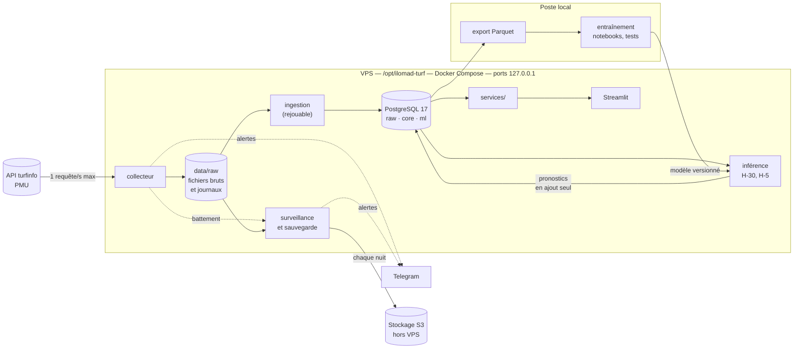

# Architecture technique — ILOMAD-TURF

> **Version** : 1.5 | **Date** : 15/10/2026 | **Auteur** : Olivier MORA avec Claude Code
> **Depuis la version 1.0** : le collecteur ne dépend plus de la base ([ADR 0005](./adr/0005-collecteur-ne-depend-que-du-disque.md)) ; un service de surveillance est ajouté ; la reprise d'historique est exécutée par le collecteur ([ADR 0006](./adr/0006-reprise-executee-par-le-collecteur.md)).
> **Livré à ce jour** : collecteur, surveillance, sauvegarde (sprint 1) ; reprise d'historique, base PostgreSQL, ingestion, contrôles de qualité (sprint 2) ; modèle 0, métriques, rapport de référence du marché, export Parquet, couche `services/`, application v0 (sprint 3) ; variables point-in-time, logit conditionnel, LightGBM, combinaison, validation glissante, protocole de décision (sprint 4). Le reste est la cible des sprints suivants.

Ce document décrit **comment** l'application est construite. Les exigences sont dans le [cahier des charges](./CAHIER-DES-CHARGES.md), le comportement de la source dans [SPEC-SOURCE-PMU.md](./SPEC-SOURCE-PMU.md), le « pourquoi » de chaque choix dans [adr/](./adr/).

---

## 1. Vue d'ensemble



Le collecteur n'écrit que sur le disque. Il ne connaît ni la base ni les autres services : rien de ce qui se passe en aval ne peut l'arrêter.

Quatre principes structurent tout le reste ([ADR 0001](./adr/0001-brut-d-abord-et-point-in-time.md)) :

1. **Brut d'abord.** Toute réponse HTTP est stockée telle quelle, avec son heure de collecte, avant tout traitement.
2. **Point-in-time.** Une variable ne voit que ce qui était connu à l'heure du pronostic.
3. **Liste blanche** des champs utilisables avant course.
4. **Pronostics en ajout seul**, antérieurs au départ.

---

## 2. Stack technique

| Composant | Choix | Justification |
|-----------|-------|---------------|
| Langage | Python 3.13 | Écosystème data et ML, compétence interne |
| Dépendances | uv | Verrouillage reproductible, rapide |
| Client HTTP | httpx | Délais et reprises maîtrisés, même API en synchrone et asynchrone |
| Base de données | PostgreSQL 17 | Contraintes fortes (ajout seul, clés étrangères), `timestamptz`, déjà maîtrisé |
| Accès aux données | SQLAlchemy 2, migrations Alembic | Schéma versionné dans le code |
| Calcul | Polars pour les tables, NumPy pour les métriques | Jointures temporelles rapides, faible empreinte mémoire |
| Modèles | Logit conditionnel écrit en NumPy, LightGBM (classement), combinaison et calibration par logit conditionnel | Progression du plus simple au plus fin, sans dépendance lourde : statsmodels et scikit-learn ne sont pas nécessaires |
| Ligne de commande | Typer | Une commande par étape : `collect`, `backfill`, `parse`, `export`, `train`, `predict`, `evaluate` |
| Interface | Streamlit | Développement rapide, un seul utilisateur |
| API | FastAPI (« Should ») | Habillage de la couche `services/` |
| Conteneurs | Docker Compose | Isolation sur un VPS partagé |
| Alertes | Bot Telegram | Aucune infrastructure à maintenir |
| Sauvegarde | `pg_dump` et rclone vers un stockage S3 | Copie hors VPS |
| Qualité | pytest, ruff | |

Ce qui est volontairement absent du MVP : MLflow, Prefect, React ([ADR 0002](./adr/0002-outillage-minimal.md)).

---

## 3. Composants

Chaque composant fait une seule chose. Tous partagent le même paquet Python `turf` et la même image Docker ; seule la commande lancée diffère.

| Composant | Rôle | Entrées | Sorties | Module |
|-----------|------|---------|---------|--------|
| **Collecteur** | Interroger la source selon le calendrier, au débit plafonné | Programme du jour, journal des tâches | Fichiers bruts, journaux du jour, battement | `collecte/` |
| **Surveillance** | Alerter si le collecteur est muet ou le disque plein ; sauvegarder chaque nuit | Battement, `data/` | Alertes, copie hors VPS | `surveillance.py` |
| **Ingestion** | Transformer le brut en tables propres ; rapprocher chevaux et personnes | Fichiers bruts et journaux | `raw.*`, `core.*` | `ingestion/` |
| **Variables** (livrées) | Calculer les variables d'un partant telles que connues avant le jour de la course | Table des partants | Colonnes `v_*` | `features/` |
| **Tables à plat** | Une ligne par partant, avec ses quatre cotes et son résultat ; lecture en base, export Parquet | `core.*` | Tableau Polars, `data/parquet/` | `export.py` |
| **Modèles** | Marché, logit conditionnel, LightGBM, combinaison, calibration (livrés) ; Plackett-Luce avec atténuation par rang (livrés) | Variables | Probabilités | `modeles/` |
| **Évaluation** | Métriques, référence du marché, validation glissante, décision (livrés) ; probabilités de place et paris fictifs en simple gagnant (livrés) | Table des partants, puis `ml.prediction` | Rapports, `ml.pari_fictif` | `evaluation/` |
| **Inférence** | Produire les pronostics à H-30 et H-5 | Modèle versionné, instantanés du jour | `ml.prediction` | `cli predict` |
| **Services** | Seule porte d'entrée de la lecture pour l'interface et l'API | `core.*`, `ml.*` | Objets métier | `services/` |
| **Application** | Programme du jour et marché, santé de la collecte (livrés) ; pronostics et performance (sprint 5) | `services/` | Pages | `app/` |

**Règle de dépendance.** `app/` et `api/` n'appellent que `services/`. Aucune page n'écrit de SQL. C'est la séparation qui permettra de remplacer Streamlit sans toucher au reste.

**Mesure du marché.** Les règles qui disent quelles courses sont évaluables, comment les quatre cotes sont comparées et pourquoi le test gelé est écarté sont dans l'[ADR 0007](./adr/0007-protocole-de-mesure-du-marche.md).

---

## 4. Une journée type

Heures de Paris. Les créneaux sont comptés par rapport à l'heure de départ prévue de chaque course.

| Moment | Action | Ressources demandées |
|--------|--------|----------------------|
| Matin | Charger le programme, planifier les tâches de chaque course, prendre un premier instantané | `programme`, `participants`, `performances-detaillees` |
| Toutes les 15 minutes | Recharger le programme pour suivre les changements d'horaire | `programme` |
| H-60, H-30, H-15, H-5, H-2 | Instantané de chaque course, sur les deux masses de paris | `participants`, `combinaisons` |
| H-30 et H-5 | Calcul et enregistrement des pronostics | — |
| Après l'arrivée | Résultat, cotes finales, rapports définitifs | `participants`, `combinaisons`, `rapports-definitifs` |
| J+1 | Rattrapage de ce qui manque | selon les manques |
| Nuit | Sauvegarde, puis reprise d'historique si elle est en cours | — |

Soit environ 1 450 requêtes et 4 Mo compressés par jour pour 51 courses en moyenne (mesures dans [SPEC-SOURCE-PMU.md](./SPEC-SOURCE-PMU.md#7-volumes-et-dimensionnement)).

**Pourquoi deux masses.** Le PMU tient deux cagnottes séparées, l'une pour les points de vente, l'autre pour internet. Leurs cotes diffèrent ([ADR 0004](./adr/0004-deux-masses-de-paris.md)).

**Pas de fenêtre horaire fixe.** Le premier départ a lieu avant 8 h 45 un jour sur vingt, le dernier après 23 h 30 un jour sur quatre. Le collecteur suit le programme du jour.

**Départs en retard.** L'horaire du programme est l'horaire prévu ; le départ réel a 1,6 minute de retard en médiane et plus de 10 minutes une fois sur vingt. Le dernier créneau se prolonge donc tant que la course n'est pas partie.

**Réponses vides.** Avant une course, une cote absente ou une réponse 204 est normale. Elle est enregistrée comme les autres, sans alerte.

**Suivi après l'horaire.** Après le départ prévu, des instantanés continuent à S+1, S+3, S+5, S+7 et S+9. Ils s'arrêtent dès que deux instantanés de suite portent le même horodatage de cote : les paris sont fermés, la course est partie.

**Tolérance.** Un créneau pris trop tard n'est plus le même créneau. Chaque instantané a une limite : 20 % de son délai (12 minutes pour H-60, 6 pour H-30), 60 secondes au moins, jamais après le départ prévu. Au-delà, la tâche est consignée « manquée ».

**Reprise après arrêt.** Les tâches se recalculent à partir du programme. Chaque tâche terminée est une ligne du journal `_taches.jsonl` du jour. Au redémarrage, le collecteur relit ce journal et saute ce qui est déjà consigné. Un créneau avant course dont l'heure est passée est marqué « manqué » : il ne se rattrape pas.

**Clôture.** Le lendemain à 10 h, le collecteur recharge une dernière fois le programme, récupère les arrivées qui manquent, écrit le bilan du jour et l'envoie sur Telegram.

**Reprise d'historique.** Le rapatriement des jours passés n'est pas un programme à part : le collecteur l'exécute lui-même, une requête à la fois, quand rien n'est dû en direct ([ADR 0006](./adr/0006-reprise-executee-par-le-collecteur.md)). Le plafond d'une requête par seconde reste ainsi global. La reprise se commande par `turf backfill`, qui dépose un fichier de demande ; elle travaille de minuit à 8 h par défaut, et produit des fichiers de même forme que le direct.

---

## 5. Données

### 5.1 Fichiers bruts

```
data/raw/AAAA/MM/JJ/
    programme__<collecte>.json.gz
    R<r>C<c>/
        <ressource>__<masse>__<collecte>.json.gz
    _documents.jsonl
    _taches.jsonl
```

- `AAAA/MM/JJ` : date du programme, en heure de Paris.
- `<collecte>` : heure de collecte en UTC, format `AAAAMMJJTHHMMSSZ`.
- `<masse>` : `OFFLINE` ou `INTERNET` ; absent pour les ressources qui n'en dépendent pas.
- Un fichier brut n'est jamais modifié ni supprimé. Un contenu identique au précédent n'est pas réécrit : le journal renvoie au fichier existant.
- `_documents.jsonl` : une ligne par réponse reçue, y compris les réponses vides (204) et les erreurs. Elle porte l'adresse, l'heure de collecte, le statut, la durée, l'empreinte SHA-256, le chemin du fichier et les en-têtes de cache.
- `_taches.jsonl` : une ligne par tâche terminée, puis une ligne de clôture avec le bilan du jour.

Ces deux journaux sont en ajout seul. Avec les fichiers bruts, ils suffisent à tout reconstruire.

### 5.2 Base PostgreSQL

Trois schémas, du plus proche de la source au plus proche du modèle.

| Schéma | Contenu | Tables | En place |
|--------|---------|--------|----------|
| `raw` | Ce que le collecteur a fait, dérivé des journaux du disque | `document`, `tache_collecte`, `ingestion` | Sprint 2 |
| `core` | Modèle relationnel propre | `hippodrome`, `reunion`, `course`, `cheval`, `personne`, `partant`, `partant_snapshot`, `enjeu`, `mise`, `resultat`, `rapport`, `performance` | Sprint 2 |
| `ml` | Modèles et pronostics | `modele_version`, `prediction`, `pari_fictif`, `evaluation` | Sprint 4 |

Conventions :

- horodatages en UTC (`timestamptz`) ; la date de programme, en heure de Paris, est conservée à part ;
- valeurs reprises telles que la source les donne, l'unité dans le nom de la colonne (`_cts`, `_ms`, `_m`) ;
- place et statut d'arrivée dans deux colonnes distinctes ;
- ce qui n'est connu qu'après la course est à l'écart, dans `core.resultat` et `core.rapport` ;
- `ml.prediction` : aucune mise à jour ni suppression, contrainte `created_at < heure_depart`.

Description des tables, unités et requêtes types : [MODELE-DONNEES.md](./MODELE-DONNEES.md).

**Ingestion.** Un service relit le disque toutes les cinq minutes et charge ce qui est nouveau. Toutes ses écritures sont des « insère, ou met à jour si la clé existe » : relire deux fois le même fichier ne change rien, et vider la base puis tout relire redonne la même base. Un document illisible est compté et signalé ; il n'empêche pas de charger les autres.

**La base n'est pas sauvegardée.** Elle se reconstruit depuis `data/raw/`, qui l'est. Cela changera avec `ml.prediction`, première table dont le contenu ne se rederive pas.

### 5.3 Identité des chevaux

L'identifiant `idCheval` de la source vaut `NOM-MÈRE-PÈRE`. Il est absent de l'historique ancien, mais ses trois composantes y sont présentes : la clé se reconstruit. `core.cheval` a donc pour clé ce triplet. Sur 4 402 partants réels de 2021 à 2026, il n'a produit ni doublon ni confusion : la table d'alias prévue par le plan est reportée, et `turf qualite` surveille les deux cas. Détail et mesures dans [SPEC-SOURCE-PMU.md](./SPEC-SOURCE-PMU.md).

---

## 6. Anti-fuite

| Règle | Mise en œuvre | Test |
|-------|---------------|------|
| Liste blanche des champs pré-course | `features/registre.py` : chaque variable déclare les champs qu'elle lit | Échoue si une variable directe lit un champ hors liste |
| Point-in-time | `features/construction.py` : tout historique est joint par une jointure temporelle stricte, le jour de la course exclu | Reconstruit une course avant son arrivée et après les jours suivants : variables identiques |
| Cote utilisée par le modèle | Uniquement une cote dont l'horodatage précède l'heure du pronostic | Test sur une course où la cote de référence est postérieure au départ prévu |
| Âge d'une réponse | La source est derrière un cache : une réponse peut dater de plusieurs minutes. L'heure d'une donnée est l'heure de collecte moins l'en-tête `age`, conservé dans `_documents.jsonl` | Test sur un document servi par le cache |
| Jeu de test gelé | Écarté d'office de toute mesure (`evaluation/periodes.py`) ; `turf decide` seul l'ouvre, marqueur posé avant tout calcul ([ADR 0008](./adr/0008-protocole-de-decision.md)) | Des courses du test gelé ajoutées aux données ne changent aucun chiffre du rapport |

Champs toujours exclus des variables d'une course : `ordreArrivee`, `tempsObtenu`, `reductionKilometrique`, `incident`, `commentaireApresCourse`, `dernierRapportDirect` (cote finale, postérieure au départ). Ils servent seulement d'historique pour les courses suivantes.

---

## 7. Environnements

| Environnement | Où | Base | Usage |
|---------------|-----|------|-------|
| Local | Poste Windows, Docker Desktop | PostgreSQL en conteneur | Développement, tests, entraînement, notebooks |
| Production | VPS partagé, `/opt/ilomad-turf/` | PostgreSQL en conteneur, volume dédié | Collecte, ingestion, inférence, application |

Il n'y a pas d'environnement de recette : un seul utilisateur, et le rejeu depuis le brut permet de reconstruire la production en local.

**Échanges entre les deux.** Les données descendent du VPS en fichiers Parquet. Le modèle entraîné remonte dans `data/models/<version>/`. Le code passe par Git.

---

## 8. Cohabitation sur le VPS

Le VPS héberge la production de trois clients ([ADR 0003](./adr/0003-vps-partage-entrainement-local.md)).

| Service | Mémoire maximale | CPU maximal | Port (127.0.0.1) | En place |
|---------|------------------|-------------|------------------|----------|
| Collecteur | 192 Mo | 0,25 | — | Sprint 1 |
| Surveillance et sauvegarde | 256 Mo | 0,25 | — | Sprint 1 |
| PostgreSQL | 512 Mo | 1,0 | 5440 | Sprint 2 |
| Ingestion et inférence (tâches ponctuelles) | 512 Mo | 1,0 | — | Sprint 2 |
| Application Streamlit | 384 Mo | 0,5 | 8510 | Sprint 3 |
| Outils à la demande (export, rapport) | 1 Go, le temps d'une commande | 1,0 | — | Sprint 3 |
| API (« Should ») | 192 Mo | 0,25 | 8010 | Sprint 6 |

Ces plafonds sont un budget de départ, à ajuster après mesure en production. Ports déjà pris par les autres projets : 3000-3001, 4000-4001, 4010-4011.

Avant toute installation : `scripts/etat_vps.sh` doit rendre un feu vert (≥ 15 Go de disque libres, ≥ 1,5 Go de mémoire disponible, ports libres).

---

## 9. Sécurité

- Aucun port public. Accès à l'application par tunnel SSH : `ssh -L 8510:127.0.0.1:8510 root@<hote>`.
- Secrets (mot de passe PostgreSQL, jeton Telegram, clés S3) dans `.env`, hors Git, droits `600`.
- Le collecteur n'a besoin que de sorties HTTPS vers le PMU, Telegram et le stockage S3.
- Les sauvegardes contiennent des noms de personnes (drivers, entraîneurs, propriétaires) : le stockage S3 reste privé.

---

## 10. Observabilité

| Signal | Où | Alerte Telegram |
|--------|-----|-----------------|
| Chaque appel HTTP (adresse, statut, durée, taille, cache) | `_documents.jsonl` du jour | — |
| Chaque tâche terminée | `_taches.jsonl` du jour, journal du conteneur | — |
| Couverture de collecte | `turf couverture`, puis page « santé de la collecte » | Bilan chaque jour à 10 h ; signalé s'il est sous 98 % |
| Refus de la source (403, 429) | Journal, `etat/source-refusee.json` | Immédiate ; la collecte se suspend une heure |
| Source injoignable | Journal | Après 5 requêtes sans réponse ; message au rétablissement |
| Programme illisible | Journal | Immédiate, puis toutes les 6 heures |
| Collecteur muet | `etat/battement.json`, lu par la surveillance | Aucun battement depuis 10 minutes |
| Disque | Surveillance, chaque minute | Occupation ≥ 80 % |
| Sauvegarde | Surveillance, chaque nuit | En cas d'échec, ou si elle n'est pas configurée |
| Document illisible par l'ingestion | Journal d'ingestion, `raw.ingestion.anomalies` | Immédiate, puis toutes les 6 heures |
| Ingestion à l'arrêt (base injoignable) | Journal d'ingestion | Immédiate, puis toutes les heures |
| Qualité de la base | `turf qualite` | — |

Aucun traitement ne s'arrête en silence : une erreur est journalisée avec son contexte, puis propagée ou transformée en alerte. Une même alerte n'est pas répétée avant une heure au moins.

La conduite à tenir pour chaque alerte est dans [EXPLOITATION.md](./EXPLOITATION.md).

---

## 11. Sauvegarde et reprise

- **Chaque nuit** à 3 h 30 : copie de `data/raw/` vers le stockage S3, par rclone. La copie n'efface jamais rien à distance.
- **Perte de la base** : la recréer et rejouer l'ingestion depuis les fichiers bruts (`turf parse --rejouer`). Quelques heures pour cinq ans de trot.
- **Perte du VPS** : réinstaller, restaurer `data/raw/` depuis S3. La perte définitive se limite aux instantanés avant course non collectés pendant la panne et à ceux pris depuis la dernière sauvegarde.

Les procédures détaillées sont dans [PLAN-DEPLOIEMENT.md](./PLAN-DEPLOIEMENT.md) (installation, mise à jour, retour arrière) et [EXPLOITATION.md](./EXPLOITATION.md) (alertes, restauration).

---

## 12. Ce qui prépare le SaaS

| Élément déjà en place | Ce qu'il permet plus tard |
|-----------------------|---------------------------|
| Couche `services/` | Brancher une API publique et une interface React sans réécrire la logique |
| Pronostics en ajout seul, horodatés, liés à une version de modèle | Publier un historique de performance vérifiable |
| Fichiers bruts conservés | Rejouer l'historique avec un nouveau schéma |
| Schémas `raw`, `core`, `ml` séparés | Remplacer la source par une source licenciée en ne touchant que `raw` et l'ingestion |

Ce qui manquera et n'est pas préparé : authentification, multi-locataires, facturation, et surtout une **licence de données**. Les données PMU collectées ici ne pourront pas alimenter un service commercial.
