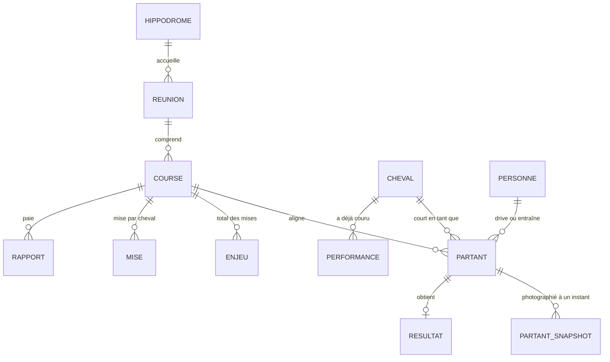

# Modèle de données — ILOMAD-TURF

> **Version** : 1.0 | **Date** : 13/10/2026 | **Base** : PostgreSQL 17
> **Source de vérité du schéma** : [src/turf/db/schema.py](../src/turf/db/schema.py). Ce document l'explique ; en cas de désaccord, le code a raison.

Ce document sert à qui écrit une requête ou une variable de modèle. Il dit ce que contient chaque table, dans quelle unité, et surtout **ce qui était connu avant la course et ce qui ne l'était pas**.

---

## 1. Trois principes

1. **La base est dérivée.** Tout son contenu vient des fichiers de `data/raw/`, lus par l'ingestion. On peut la vider et la reconstruire à l'identique : `turf parse --rejouer`. Elle n'est donc pas sauvegardée.
2. **Les valeurs sont celles de la source.** Aucune conversion d'unité, aucun arrondi : les montants restent en centimes, les temps en millisecondes. Le suffixe de la colonne donne l'unité.
3. **Avant et après la course ne se mélangent pas.** Ce qui n'est connu qu'après l'arrivée est dans `core.resultat`, `core.rapport`, et trois colonnes de `core.course`. Tout le reste est connu avant, à une réserve près : les cotes, qui ont chacune leur propre horodatage (§ 5).

---

## 2. Vue d'ensemble



| Schéma | Rôle | Tables |
|--------|------|--------|
| `raw` | Ce que le collecteur a fait | `document`, `tache_collecte`, `ingestion` |
| `core` | Les courses, proprement | `hippodrome`, `reunion`, `course`, `cheval`, `personne`, `partant`, `partant_snapshot`, `enjeu`, `mise`, `resultat`, `rapport`, `performance` |

Le schéma `ml` (versions de modèle, pronostics, paris fictifs) arrive au sprint 4.

---

## 3. Unités

| Suffixe | Unité | Exemple |
|---------|-------|---------|
| `_cts` | Centimes d'euro | `gains_carriere_cts = 4014000` : 40 140 € |
| `_eur` | Euros | `allocation_eur = 33000` |
| `_ms` | Millisecondes | `reduction_km_ms = 73200` : 1'13"2 au kilomètre |
| `_cs` | Centièmes de seconde | `reduction_km_cs = 7470` : 1'14"7 au kilomètre |
| `_m` | Mètres | `distance_m = 2700` |
| `_s` | Secondes | `age_s = 4` |
| `_le` | Instant, en UTC (`timestamptz`) | `cote_reference_le` |

**Piège.** La réduction kilométrique est en millisecondes dans `core.resultat` et en centièmes de seconde dans `core.performance`. Ce n'est pas un choix : la source donne deux unités selon l'endroit.

`date_programme` est la date du programme en heure de Paris. Une course de nuit courue à 0 h 30 appartient au programme de la veille.

---

## 4. Les tables

### 4.1 `core.course`

Une ligne par course. Clé : `(date_programme, reunion, numero)`.

| Colonne | Contenu |
|---------|---------|
| `depart_prevu` | Horaire **prévu**. Le départ réel a souvent quelques minutes de retard |
| `discipline`, `specialite` | `ATTELE` / `TROT_ATTELE`, `MONTE` / `TROT_MONTE`, `PLAT`, `HAIE`… |
| `distance_m`, `corde`, `type_piste` | Parcours |
| `categorie_particularite` | `AUTOSTART`, `COURSE_A_CONDITIONS`, `A_RECLAMER`… |
| `allocation_eur`, `partants_declares` | |
| `categorie_statut` | `A_PARTIR`, `EN_COURS`, `ARRIVEE`, `ANNULEE` |
| `duree_ms`, `arrivee`, `incidents` | **Après la course.** `arrivee` est une liste de listes : `[[11], [4], [1]]` ; une sous-liste de deux numéros est un ex æquo |

`core.reunion` porte l'hippodrome, le pays et la météo prévue (`meteo_temperature`, `meteo_force_vent`…).

### 4.2 `core.cheval`

Une ligne par cheval. Clé : `cle`, de la forme `NOM-MÈRE-PÈRE`.

N'y figure que ce qui ne change pas : nom, père, mère, race, année de naissance. Le sexe (un mâle peut être castré) et l'âge sont sur `core.partant`.

`rapproche` est faux quand le père ou la mère manque : le cheval n'est alors identifié que par son nom, et deux homonymes seraient confondus. Sur 4 402 partants réels de 2021 à 2026, aucun cas.

### 4.3 `core.personne`

Une ligne par nom, tel que la source l'écrit : `J.M. BAZIRE`. Drivers, jockeys et entraîneurs y sont confondus ; une même personne qui entraîne et drive n'a qu'une ligne.

**Limite.** La source ne donne qu'une initiale et un nom. Deux personnes de même initiale et de même nom sont une seule ligne. Propriétaires et éleveurs ne sont pas des personnes : ce sont deux colonnes de texte sur `core.partant`.

### 4.4 `core.partant`

Un cheval dans une course. Clé : `(course_id, numero)`. **Tout y est connu avant la course.**

| Colonnes | Contenu |
|----------|---------|
| `cheval_id`, `driver_id`, `entraineur_id` | |
| `age`, `sexe` | À la date de la course |
| `statut` | `PARTANT` ou `NON_PARTANT`, **dernier état connu** |
| `deferre`, `driver_change`, `avis_entraineur` | Dernier état connu. `avis_entraineur` n'existe qu'à partir de 2023 |
| `distance_m` | Distance à parcourir par ce cheval, rendement de distance compris |
| `musique`, `courses`, `victoires`, `places`, `gains_*_cts` | Carrière **avant** cette course. Vérifié sur l'historique : la source ne les met pas à jour après coup |

« Dernier état connu » : pour une course suivie en direct, la ligne reflète la dernière réponse reçue. L'état à un instant précis se lit dans `core.partant_snapshot`.

`courses` ne compte pas toujours toute la carrière d'un cheval étranger ([SPEC-SOURCE-PMU.md § 4.3](./SPEC-SOURCE-PMU.md)).

### 4.5 `core.partant_snapshot`

Une photo d'un partant, pour une masse de paris, à un instant. Clé : `(partant_id, masse, recupere_le)`.

| Colonne | Contenu |
|---------|---------|
| `masse` | `OFFLINE` (points de vente) ou `INTERNET` : deux cagnottes, deux jeux de cotes |
| `creneau` | `matin`, `H-60`… `H-2`, `S+1`… `S+9`, `arrivee`, ou `reprise` pour l'historique |
| `recupere_le`, `age_s` | Quand la réponse a été reçue, et son âge si elle sortait d'un cache |
| `statut`, `driver_id`, `deferre` | État du partant sur cette photo |
| `cote_reference`, `cote_reference_le` | Cote de référence et **son** horodatage : en général 30 minutes avant le départ prévu |
| `cote_directe`, `cote_directe_le` | Cote du moment et **son** horodatage. Sur une photo d'arrivée ou de reprise, c'est la cote finale |

C'est la table la plus importante, et la plus piégeuse : voir § 5.

### 4.6 `core.enjeu` et `core.mise`

`core.enjeu` : total des mises d'un pari, pour une masse, à un instant. `core.mise` : la mise sur chaque cheval, pour les paris à un seul cheval (`SIMPLE_GAGNANT`, `SIMPLE_PLACE`, et leurs équivalents `E_…` sur internet).

**Limite.** La source ne détaille que les 12 chevaux les plus joués. Dans un peloton de 16, les 4 moins joués n'ont pas de ligne ; leur mise totale est `total_cts` moins la somme des autres. Pour environ 10 % des courses, la source ne donne aucun détail : les tables sont vides pour ces courses, et la probabilité du marché se calcule alors avec les cotes.

### 4.7 `core.resultat` — après la course

Une ligne par partant d'une course courue. **Un modèle qui lit cette table pour la course qu'il pronostique triche.**

| Colonne | Contenu |
|---------|---------|
| `place` | Rang d'arrivée. Vide pour un cheval non classé |
| `statut_arrivee` | `CLASSE`, `NON_CLASSE`, `NON_PARTANT`, ou l'incident : `DISQUALIFIE_POUR_ALLURE_IRREGULIERE`, `ARRETE`, `TOMBE`, `DISTANCE`, `RESTE_AU_POTEAU`, `DISQUALIFIE_POTEAU_GALOP`, `DEROBE` |
| `ex_aequo` | |
| `temps_ms`, `reduction_km_ms` | |
| `commentaire` | Commentaire d'après course (2026 uniquement) |

La place et le statut sont deux colonnes parce que ce sont deux informations : au trot, un partant sur cinq est disqualifié, et il n'a pas de place.

### 4.8 `core.rapport` — après la course

Ce que chaque pari a payé. Clé : `(course_id, masse, type_pari, combinaison, libelle)`.

`dividende_pour_un_euro_cts = 170` : 1,70 € pour 1 € misé. Le libellé fait partie de la clé parce qu'une même combinaison peut payer plusieurs fois (« Mini Multi en 4 », « en 5 », « en 6 »).

### 4.9 `core.performance`

Les cinq dernières courses de chaque cheval, telles que la source les résume. Clé : `(cheval_id, date_course, nom_prix)`.

C'est la seule trace des courses courues hors du flux PMU (un tiers du trot français) ou avant le début de l'historique. Elle ne se joint pas à `core.course` : l'hippodrome et le prix y sont du texte libre.

**Limites.** Au-delà de la 5e place, `place` est vide et `statut_arrivee` vaut `NON_PLACE`. `premiers` liste les autres chevaux cités, en JSON.

### 4.10 Schéma `raw`

| Table | Contenu | Clé |
|-------|---------|-----|
| `raw.document` | Une ligne par réponse reçue de la source, erreurs et réponses vides comprises | `(date_programme, ligne)` |
| `raw.tache_collecte` | Une ligne par tâche terminée : faite, manquée, en échec, sans objet | `(date_programme, ligne)` |
| `raw.ingestion` | Jusqu'où l'ingestion a lu chaque jour, et combien de documents elle n'a pas su lire | `date_programme` |

`ligne` est le rang dans le journal du jour (`_documents.jsonl`, `_taches.jsonl`). Une même tâche peut avoir plusieurs lignes si la course a été reportée : la plus récente fait foi.

---

## 5. Les cotes : quand étaient-elles connues ?

Chaque cote a son propre horodatage, donné par la source. **C'est lui, et non `recupere_le`, qui dit quand la cote était connue.**

| Photo | `cote_reference_le` | `cote_directe_le` | `recupere_le` |
|-------|---------------------|-------------------|---------------|
| En direct, à H-5 | H-30 | H-5, à quelques secondes près | H-5 |
| À l'arrivée | H-30 | Fermeture des paris, ou peu après | Après l'arrivée |
| Reprise d'historique | H-30 | Fermeture des paris | Des années plus tard |

Règle pour une variable calculée à l'instant `t` d'une course : **n'utiliser une cote que si son horodatage est antérieur à `t`.**

- Dans l'historique, seule la cote de référence peut donc servir de variable, et seulement si `cote_reference_le` précède `t`. Dans 4,5 % des courses, elle est à moins de 20 minutes du départ.
- La cote directe d'une photo d'arrivée ou de reprise est la cote finale : elle sert de **référence à battre**, jamais de variable.
- En direct, la cote directe d'une photo H-30 ou H-5 est utilisable par un pronostic fait après cette photo.

---

## 6. Requêtes utiles

Toutes vérifiées sur des données réelles.

**Probabilités du marché, à la cote de référence des points de vente**

```sql
SELECT p.numero, ch.nom, s.cote_reference,
       round(((1 / s.cote_reference) / sum(1 / s.cote_reference) OVER ())::numeric, 4) AS proba_marche
FROM core.course c
JOIN core.partant p ON p.course_id = c.id
JOIN core.cheval ch ON ch.id = p.cheval_id
JOIN core.partant_snapshot s ON s.partant_id = p.id
WHERE c.date_programme = '2021-01-10' AND c.reunion = 1 AND c.numero = 2
  AND s.masse = 'OFFLINE' AND s.cote_reference IS NOT NULL AND p.statut = 'PARTANT'
ORDER BY proba_marche DESC;
```

La somme des `1 / cote` dépasse 1 : c'est le prélèvement. La division par cette somme ramène les probabilités à un total de 1.

**Dernière cote connue à un instant donné**

```sql
SELECT DISTINCT ON (p.numero) p.numero, s.cote_directe, s.cote_directe_le
FROM core.course c
JOIN core.partant p ON p.course_id = c.id
JOIN core.partant_snapshot s ON s.partant_id = p.id
WHERE c.date_programme = '2026-10-12' AND c.reunion = 6 AND c.numero = 11
  AND s.masse = 'INTERNET'
  AND s.cote_directe_le <= c.depart_prevu - interval '5 minutes'
ORDER BY p.numero, s.cote_directe_le DESC;
```

**Carrière d'un cheval dans la base**

```sql
SELECT c.date_programme, c.reunion, c.numero, p.courses, r.place, r.statut_arrivee, r.reduction_km_ms
FROM core.cheval ch
JOIN core.partant p ON p.cheval_id = ch.id
JOIN core.course c ON c.id = p.course_id
LEFT JOIN core.resultat r ON r.partant_id = p.id
WHERE ch.nom = 'GENTLY DE MUZE'
ORDER BY c.date_programme;
```

**Taux de retour du Simple Gagnant d'une course**

```sql
SELECT e.masse, e.total_cts / 100.0 AS enjeux_eur, m.numero AS gagnant,
       round((rp.dividende_pour_un_euro_cts / 100.0 * m.montant_cts / e.total_cts)::numeric, 3) AS taux_de_retour
FROM core.course c
JOIN core.enjeu e ON e.course_id = c.id AND e.type_pari IN ('SIMPLE_GAGNANT', 'E_SIMPLE_GAGNANT')
JOIN core.rapport rp ON rp.course_id = c.id AND rp.masse = e.masse AND rp.type_pari = e.type_pari
JOIN core.mise m ON m.course_id = c.id AND m.masse = e.masse AND m.type_pari = e.type_pari
                AND m.recupere_le = e.recupere_le AND m.numero = rp.combinaison::int
WHERE c.date_programme = '2021-01-10' AND c.reunion = 1 AND c.numero = 2;
```

Résultat sur cette course : 127 241,86 € d'enjeux, taux de retour 0,819.

**Couverture de la collecte, jour par jour**

```sql
SELECT date_programme,
       count(*) FILTER (WHERE etat = 'faite') AS pris,
       count(*) FILTER (WHERE etat IN ('manquee', 'echec')) AS perdus
FROM (SELECT DISTINCT ON (cle) * FROM raw.tache_collecte
      WHERE famille = 'avant' ORDER BY cle, ligne DESC) AS dernier_etat
GROUP BY date_programme ORDER BY date_programme;
```

---

## 7. Qualité

`turf qualite` lance dix contrôles et dit, pour chacun, combien de cas sur combien.

| Contrôle | Ce qu'il révèle |
|----------|-----------------|
| Courses arrivées sans partant | Une réponse `participants` manquante |
| Courses sans gagnant, partants sans résultat | Une arrivée non collectée ou mal lue |
| Écart sur le nombre de partants | Un partant en trop ou en moins |
| **Chevaux non rapprochés** | Père ou mère absent. **Bloquant au-delà de 1 %** (critère du plan) |
| Âge incohérent | Deux chevaux différents sous une même clé |
| Noms à plusieurs clés | Homonymes, ou père et mère écrits de deux façons |
| Courses de trot sans cote de référence | Environ 1 % sur l'historique : c'est la source |
| Documents en erreur, jours avec anomalies | Réponses refusées par la source, ou illisibles |

Sur 16 jours réels répartis de 2021 à 2026 (334 courses de trot, 4 402 partants) : tout est à zéro, sauf 4 courses sans cote de référence, déjà relevées par le spike.

---

## 8. Limites connues

- **Pas de table d'alias pour les chevaux.** Le plan en prévoyait une. La clé `NOM-MÈRE-PÈRE` n'a produit aucun doublon ni aucune confusion sur l'échantillon ; la table sera ajoutée si le contrôle « noms à plusieurs clés » en montre le besoin sur les cinq ans.
- **Les non-partants tardifs.** Dans l'historique, `statut` est l'état final : on ne sait pas à quelle heure un cheval a été retiré. Un modèle évalué sur l'historique « sait » donc qui ne partira pas. Le biais est léger, documenté dans le plan, et absent des données collectées en direct.
- **Les cotes de référence des points de vente sont incomplètes sur les réunions régionales.** Le 12/10/2026, 32 partants sur 84 en avaient une, contre 84 sur 84 sur internet.
- **Les courses étrangères.** Les cotes affichées par le PMU avant la course peuvent différer fortement de la cote finale : sur une course argentine du 12/10/2026, un cheval est passé de 6,9 à 22,0 entre la dernière photo et l'arrivée.

---

## 9. Faire évoluer le schéma

1. Modifier [src/turf/db/schema.py](../src/turf/db/schema.py).
2. Générer la migration, sur une base de test à jour :

```powershell
$env:TURF_BASE_URL = "postgresql+psycopg://turf@127.0.0.1:5440/turf_test"
.\.venv\Scripts\alembic.exe revision --autogenerate -m "description du changement"
```

3. Relire le fichier créé dans `src/turf/db/migrations/versions/`. Alembic ne crée pas les schémas et ne voit pas tout.
4. Lancer les tests : l'un d'eux échoue si la migration et le schéma déclaré diffèrent.

En production, la migration est appliquée par le service d'ingestion à son démarrage. Comme la base est dérivée, une migration difficile peut toujours être remplacée par un rejeu complet.

---

## 10. Nommage

Tables et colonnes sont en minuscules avec des tirets bas, dans des schémas PostgreSQL. La convention de l'espace de travail demande des noms de tables en `PascalCase` ; elle n'est pas suivie ici. PostgreSQL met en minuscules tout nom non entouré de guillemets : des tables en `PascalCase` imposeraient des guillemets dans chaque requête. Les noms retenus sont ceux du plan de réalisation approuvé.
